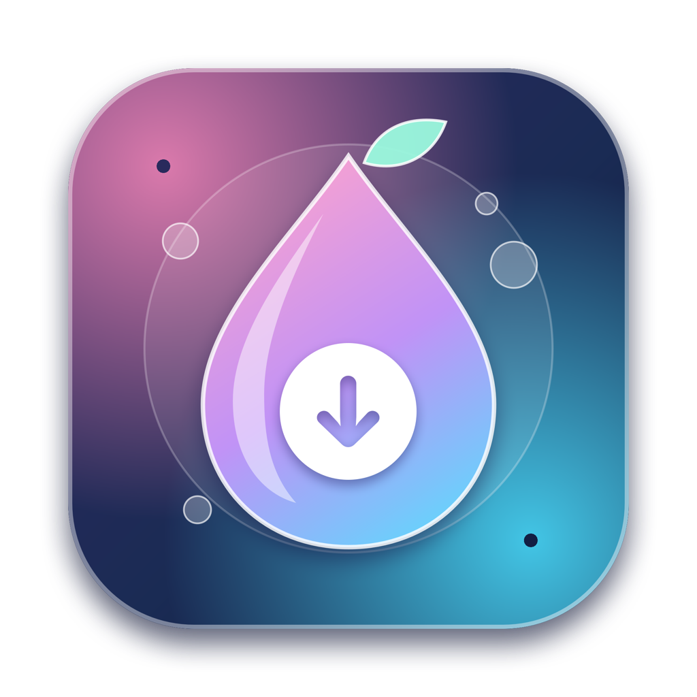
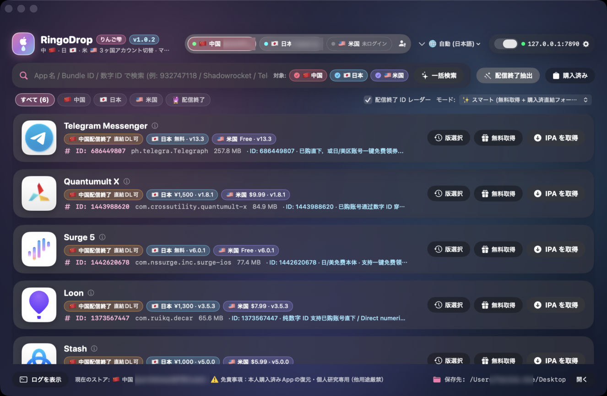
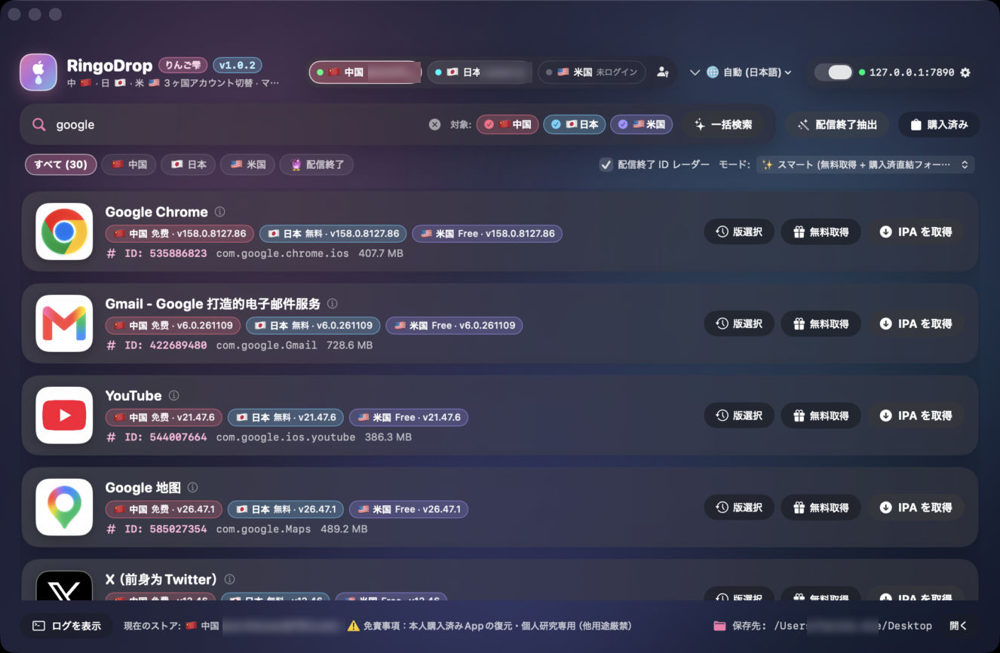

<div align="center">



# 🍎💧 RingoDrop (りんご雫)

**A native macOS SwiftUI Liquid Glass App Store `.ipa` searcher, CN/JP/US multi-account switcher & delisted app extractor.**

[](https://www.apple.com/macos/)
[](https://swift.org)
[](https://developer.apple.com/xcode/swiftui/)
[](./LICENSE)

[🇨🇳 简体中文](./README.md) · [🇯🇵 日本語](./README.ja.md) · **🇺🇸 English**

</div>

---

## ✨ Introduction

**RingoDrop (りんご雫, meaning "crystal apple dewdrop")** is a native macOS SwiftUI **Liquid Glass** client for searching, claiming free licenses, and downloading signed `.ipa` packages directly from Apple's App Store distribution servers, powered by Apple's public iTunes Lookup API and [`ipatool`](https://github.com/majd/ipatool).

- Manage and switch between **🇨🇳 China (CN) / 🇯🇵 Japan (JP) / 🇺🇸 United States (US)** Apple IDs directly from the top bar without repeatedly signing out on your iPhone.
- Search **any combination of 1 to 3 storefronts concurrently**, deduplicated by global `trackId`, comparing regional availability, pricing, and versions side by side.
- Recover **delisted or region-removed apps** under a single storefront account using **pure numeric App ID direct extraction (`-i <AppID>`)**, bypassing storefront catalog restrictions while keeping Apple's official FairPlay `sinf` signature intact.

> [!IMPORTANT]
> **⚠️ Disclaimer**  
> 1. This project is strictly intended **solely for recovering lost backups of apps that you have legitimately purchased/acquired yourself, and for personal non-commercial technical research**. Any other use—including commercial distribution, piracy, or violation of local laws or Apple Media Services Terms—is strictly prohibited.  
> 2. This tool does **not** crack, bypass, or strip Apple FairPlay DRM. Every `.ipa` downloaded retains Apple's official `sinf` signature bound to your own Apple ID and will only run on devices authorized by that Apple ID.  
> 3. Users assume full legal responsibility and account risk for their use of this tool.

---

## 📸 Screenshots

### 1. Main UI · 3-Region Account Dock & Delisted App Direct Access
> Top bar provides 1-click switching across **🇨🇳 CN / 🇯🇵 JP / 🇺🇸 US** Apple IDs, **ZH / JA / EN** language switcher (auto-matches macOS system language by default), and built-in HTTP/HTTPS proxy toggle.



### 2. Multi-Country Parallel Search (🇨🇳 CN + 🇯🇵 JP + 🇺🇸 US)
> Select any combination of storefronts to search in parallel, compare prices & versions per region on a single card, hover for a top-level floating detail card, select historical versions, or claim & download `.ipa` in one click.



---

## 🌸 Key Features

### 1. 💧 Native macOS Liquid Glass UI & Trilingual Support (ZH / JA / EN)
- Uses **macOS 26 native `.glassEffect()`** refractive shaders (with a graceful translucent specular glass fallback on macOS 14 / 15).
- Styled with a Japanese **Sakura Pink × Sora Cyan × Sumire Violet** ambient aurora backdrop and a custom `1024×1024` crystal dewdrop `AppIcon.icns`.
- Full **🇨🇳 Simplified Chinese / 🇯🇵 Japanese / 🇺🇸 English** localization—automatically matches your macOS system language on launch and can be manually switched anytime from the top bar.

### 2. 🇨🇳 · 🇯🇵 · 🇺🇸 3-Region Apple ID Account Dock
- Dedicated slots for **CN**, **JP**, and **US** Apple IDs in the top bar.
- Credentials are stored exclusively in your local **macOS Keychain** (`SecItem`), and per-region 2FA trust cookies (`~/.ipatool/cookies.<REGION>`) are snapshotted independently for fast account switching.

### 3. 🔍 Selectable Multi-Country Joint Search
- Toggle **`[✓ 🇨🇳CN]` `[✓ 🇯🇵JP]` `[✓ 🇺🇸US]`** freely to search one, two, or all three storefronts in parallel.
- Automatically merges results by global `trackId` and displays each region's price (`¥` / `無料` / `Free` / `$`), version, bundle ID, and package size.

### 4. 🔮 Single-Store Delisted / Unlisted App Extractor (Purchased / Unpurchased / Free)

| Strategy | Best For | Under the Hood |
| :--- | :--- | :--- |
| **✨ Smart Auto (Default)** | General free apps & purchased delisted apps | Attempts `--purchase` first to auto-claim free licenses, then seamlessly falls back to pure numeric ID (`-i <AppID>`) direct download if the storefront purchase endpoint rejects a delisted app. |
| **🔓 Purchased Direct** | Apps delisted from your storefront that your account previously owned | Passes **only `-i <AppID>`** (never `-b` Bundle ID), completely skipping storefront `Lookup` & `Purchase` checks to pull directly from Apple's CDN. |
| **🎁 Force Claim Free** | Unpurchased free apps (or hidden/unlisted free apps) | Explicitly runs `ipatool purchase -i <AppID>` to bind a zero-price license to the active Apple ID before downloading the `.ipa`. |

- **Delisted App ID Radar**: When searching in single-store mode (e.g., CN only) for an app delisted in that region, RingoDrop automatically queries cross-store metadata to recover its global numeric `trackId` so you can extract it directly.

### 5. 🕰️ Historical Version Selector & Phased-Release Bypass
- Click **Versions** on any app card to fetch all available `externalVersionIdentifiers` via `ipatool list-versions -i <AppID>`.
- Download older historical `.ipa` builds for downgrading, or pull the newest build immediately during Apple's 7-day Phased Release rollout.

### 6. 🌐 Configurable HTTP/HTTPS Proxy
- Built-in proxy switch & URL configuration (default `http://127.0.0.1:7890`) applied to both iTunes catalog `URLSession` requests and `ipatool` subprocesses (`fpinit.itunes.apple.com`), avoiding TLS handshake timeouts.

---

## 🚀 Quick Start

### 1. Prerequisite (`ipatool`)
RingoDrop uses [`ipatool`](https://github.com/majd/ipatool) for Apple FairPlay SAP authentication and `.ipa` assembly. Install it via Homebrew:

```bash
brew install ipatool
```

### 2. Download Prebuilt Binary (Recommended)
Grab the latest **`RingoDrop-v*-macOS.dmg`** (or `.zip`) from [GitHub Releases](https://github.com/zorroforever/RingoDrop/releases) and drag **`RingoDrop.app`** into `/Applications`.

*(If macOS Gatekeeper warns about an unsigned app on first launch, run:)*

```bash
xattr -cr /Applications/RingoDrop.app
```

### 3. Build from Source

```bash
git clone https://github.com/zorroforever/RingoDrop.git
cd RingoDrop
chmod +x scripts/build_app.sh scripts/generate_icon.swift
./scripts/build_app.sh
```

Or build / open via Swift Package Manager & Xcode:

```bash
swift build -c release
# or
open Package.swift
```

---

## 🔒 Privacy & Security

- **100% Local**: Zero third-party servers or telemetry. All network traffic goes directly between your Mac and official Apple endpoints.
- **macOS Keychain**: Saved passwords live strictly in your local macOS Keychain, and console logs automatically mask password flags (`-p ********`).

---

## ⚠️ Disclaimer

- This software and source code are provided **exclusively for recovering lost backups of apps you legitimately purchased/owned and for personal non-commercial technical research**. Any other use is strictly prohibited.
- RingoDrop never modifies app binaries or bypasses Apple FairPlay DRM. Please support app developers by purchasing software legitimately.

---

## 📄 License

Released under the [MIT License](./LICENSE). Powered by [@majd/ipatool](https://github.com/majd/ipatool).
