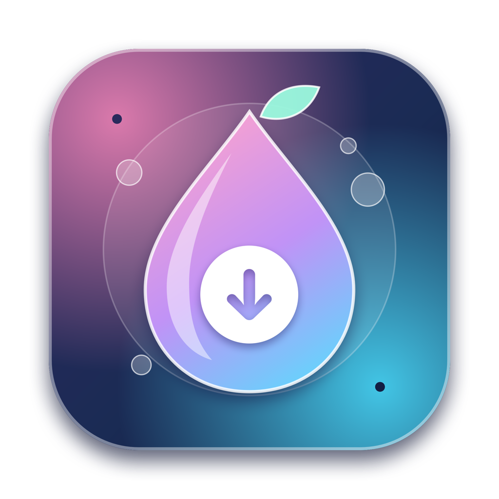
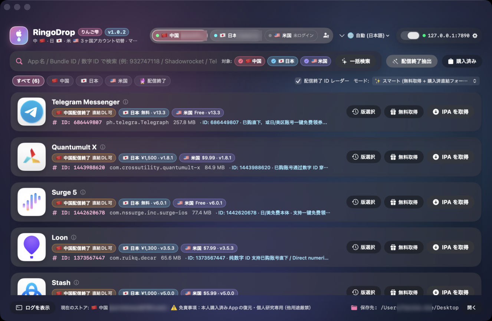
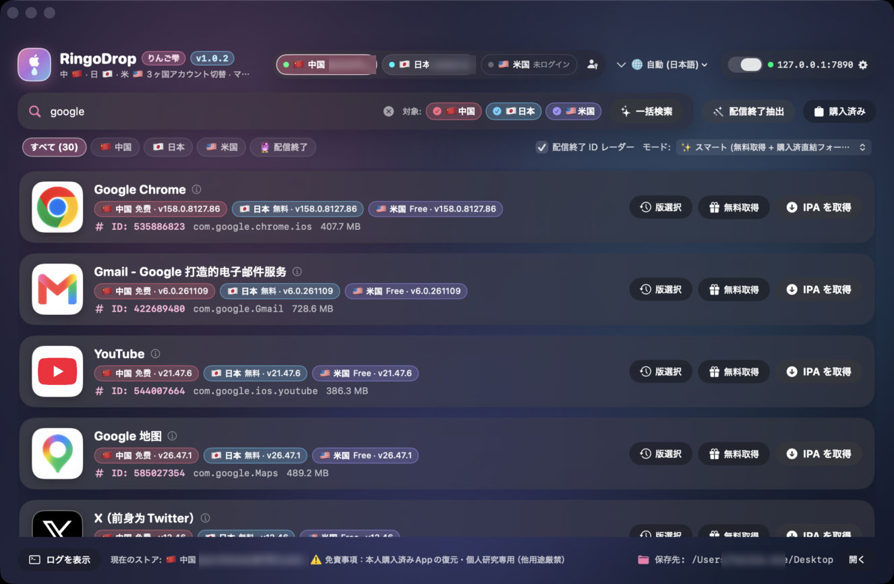

<div align="center">



# 🍎💧 RingoDrop（りんご雫）

**macOS ネイティブ SwiftUI Liquid Glass デザインによる App Store `.ipa` マルチストア検索・3ヶ国アカウント切替・配信終了アプリ抽出ツール**

[](https://www.apple.com/macos/)
[](https://swift.org)
[](https://developer.apple.com/xcode/swiftui/)
[](./LICENSE)

[🇨🇳 简体中文](./README.md) · **🇯🇵 日本語** · [🇺🇸 English](./README.en.md)

</div>

---

## ✨ 概要

**RingoDrop（りんご雫）** は、macOS ネイティブの **SwiftUI Liquid Glass** スタイルで構築された App Store `.ipa` 検索・ダウンロードクライアントです。Apple iTunes 公開カタログ API と [`ipatool`](https://github.com/majd/ipatool) の配信プロトコルを組み合わせて動作します。

- 端末や iTunes で何度もサインアウト／サインインし直すことなく、上部バーから **🇨🇳 中国 / 🇯🇵 日本 / 🇺🇸 米国** の 3 ヶ国 Apple ID をワンクリックで管理・切替可能。
- **1〜3 ヶ国を自由にチェック選択**して並列検索でき、各国の配信状況・現地通貨価格・最新バージョンを同一カード上で比較可能。
- 特定の国で**配信終了（削除）されたアプリ**についても、単一国モードで自動的にグローバル共通の数字 `App ID`（`trackId` / `adamId`）を特定し、**純粋な数字 ID 直結モード（`-i <AppID>`）** によりストアフロントのカタログ制限を回避して、Apple 公式 FairPlay 署名付きの `.ipa` を CDN から直接取得できます。

> [!IMPORTANT]
> **⚠️ 免責事項（Disclaimer）**  
> 1. 本プロジェクトは、**ユーザー自身が過去に正当に購入・入手し紛失したアプリのバックアップ復元、および個人的な技術研究・学習目的のみに厳格に限定**されます。商用利用、不正配布、海賊版共有、または法令および Apple メディアサービス利用規約に違反するその他一切の用途を固く禁じます。  
> 2. 本ツールは Apple の FairPlay DRM を解除・回避・改変する機能を**一切提供しません**。ダウンロードされるすべての `.ipa` には、ユーザー本人の Apple ID に紐づいた公式 `sinf` 署名がそのまま保持され、そのアカウントで認証されたデバイスでのみ動作します。  
> 3. 本ツールの利用に伴う一切の責任およびリスクは利用者本人に帰属し、開発者はいかなる悪用・損害についても責任を負いません。

---

## 📸 スクリーンショット

### 1. メイン画面 · 3ヶ国アカウント切替 & 配信終了アプリ直通リスト
> 上部バーで **🇨🇳 中国 / 🇯🇵 日本 / 🇺🇸 米国** の 3 ヶ国 Apple ID 切替、**中 / 日 / 英** の 3 言語切替（デフォルトはシステム言語に追従）、HTTP/HTTPS プロキシ設定を完結できます。



### 2. マルチストア並列検索（🇨🇳 中国 + 🇯🇵 日本 + 🇺🇸 米国）
> 1〜3 ヶ国を自由に選んで同時検索。各国での配信状況・価格・最新バージョン・サイズを一覧表示し、マウスホバーで最前面のフロート詳細カードを表示します。



---

## 🌸 主な機能

### 1. 💧 ネイティブ macOS Liquid Glass UI & 3 言語対応
- **macOS 26 (`.glassEffect()`)** のネイティブ Liquid Glass シェーダーに対応（macOS 14 / 15 では高精細磨りガラス＋鏡面エッジハイライトに自動フォールバック）。
- **桜 (Sakura Pink) × 空 (Sora Cyan) × 菫 (Sumire Violet)** の和モダンなオーロラ背景を採用。
- **🇨🇳 简体中文 / 🇯🇵 日本語 / 🇺🇸 English** の 3 言語に対応し、デフォルトで macOS のシステム言語に自動一致。上部バーからいつでも手動切替可能です。

### 2. 🇨🇳 · 🇯🇵 · 🇺🇸 3 ヶ国 Apple ID 管理 & ワンクリック切替
- 上部バーに **🇨🇳 中国**・**🇯🇵 日本**・**🇺🇸 米国** の 3 スロットを常駐。
- パスワードはローカルの **macOS キーチェーン（Keychain）** に安全に保存され、2FA 認証済みのセッション Cookie（`~/.ipatool/cookies.<REGION>`）を国別にスナップショット保存するため、切替時の再認証の手間を大幅に削減します。

### 3. 🔍 自由選択できるマルチストア並列検索
- **`[✓ 🇨🇳中国]` `[✓ 🇯🇵日本]` `[✓ 🇺🇸米国]`** のチェックボックスから任意の組み合わせで検索可能。
- グローバル共通の `trackId` で重複を自動統合し、各国の価格（`¥` / `無料` / `Free` / `$`）とバージョンを並べて比較できます。

### 4. 🔮 単一国での配信終了 / 非公開アプリ直結抽出（購入済 / 未購入 / 無料）

| 取得モード | 対象ケース | 仕組み |
| :--- | :--- | :--- |
| **✨ スマート（既定）** | 一般的な無料アプリ & 購入済み配信終了アプリ | まず `--purchase` 付きで無料ライセンス自動取得＆ダウンロードを試行。配信終了による拒否時は自動的に純粋な数字 ID 直結モードへフォールバックします。 |
| **🔓 購入済み直結** | 配信終了済みだが、アカウントに購入履歴があるアプリ | **`-i <数字ID>` のみを指定**（`-b` Bundle ID は不使用）し、ストアの `Lookup` や `Purchase` チェックを完全にスキップして Apple CDN から最新版 `.ipa` を取得します。 |
| **🎁 未購入無料強制取得** | 未購入だがダウンロード権限がある無料アプリ | 数字 ID で `ipatool purchase -i <AppID>` を明示実行し、0 円ライセンスをアカウントに紐づけてから `.ipa` を取得します。 |

- **配信終了 App ID レーダー**：単一国（例：中国ストアのみ）で配信終了アプリを検索して 0 件だった場合、越境カタログからグローバル共通の数字 ID を自動特定し、そのまま単一国アカウントで直結抽出できます。

### 5. 🕰️ 履歴バージョン選択（ダウングレード / 段階リリース先行取得）
- 各カードの **「版選択」** をクリックすると、`ipatool list-versions -i <AppID>` で Apple サーバー上の全 `externalVersionIdentifiers` を取得します。
- 7 日間の段階的リリース（Phased Release）中でも最新ビルド ID を直接選んで先行取得でき、旧バージョン ID を選べばダウングレード用 `.ipa` も取得できます。

### 6. 🌐 HTTP/HTTPS プロキシ設定内蔵
- 上部バーからプロキシの ON/OFF とアドレス（既定 `http://127.0.0.1:7890`）を設定可能。ストア検索（`URLSession`）と `ipatool` の FairPlay 署名通信（`fpinit.itunes.apple.com`）の両方に自動適用されます。

---

## 🚀 クイックスタート

### 1. 事前準備（`ipatool` のインストール）
RingoDrop は FairPlay 署名と `.ipa` 生成に [`ipatool`](https://github.com/majd/ipatool) を使用します。Homebrew でインストールしてください：

```bash
brew install ipatool
```

### 2. ビルド済みバイナリのダウンロード（推奨）
[GitHub Releases](https://github.com/zorroforever/RingoDrop/releases) から最新の **`RingoDrop-v*-macOS.dmg`**（または `.zip`）をダウンロードし、**`RingoDrop.app`** を `Applications` フォルダへドラッグしてください。

*(初回起動時に未署名アプリの警告が出た場合は、ターミナルで以下を実行してください)*

```bash
xattr -cr /Applications/RingoDrop.app
```

### 3. ソースからビルド

```bash
git clone https://github.com/zorroforever/RingoDrop.git
cd RingoDrop
chmod +x scripts/build_app.sh scripts/generate_icon.swift
./scripts/build_app.sh
```

または SwiftPM / Xcode で直接開くこともできます：

```bash
swift build -c release
# または
open Package.swift
```

---

## 🔒 プライバシーとセキュリティ

- **完全ローカル動作**：第三者サーバーやアナリティクスは一切含まれていません。すべての通信はお使いの Mac と Apple 公式サーバー間のみで直接行われます。
- **キーチェーン保護**：保存されたパスワードは macOS キーチェーンに暗号化保管され、コンソールログ上のパスワード引数も自動的にマスキング（`-p ********`）されます。

---

## ⚠️ 免責事項 | Disclaimer

- 本ソフトウェアおよびソースコードは、**ユーザー自身が正当に購入・所有していたアプリの復元および個人的な非商用研究のみ**を目的としており、その他のいかなる用途にも使用してはなりません。
- 本ツールは Apple FairPlay DRM の保護を一切解除・改変しません。正規アプリの開発者を尊重し、ルールを遵守してご利用ください。
- 本プロジェクトのダウンロード・ビルド・使用をもって上記に同意したものとみなされます。

---

## 📄 ライセンス

[MIT License](./LICENSE) の下で公開されています。基盤となる App Store プロトコル実装を提供している [@majd/ipatool](https://github.com/majd/ipatool) に感謝します。
