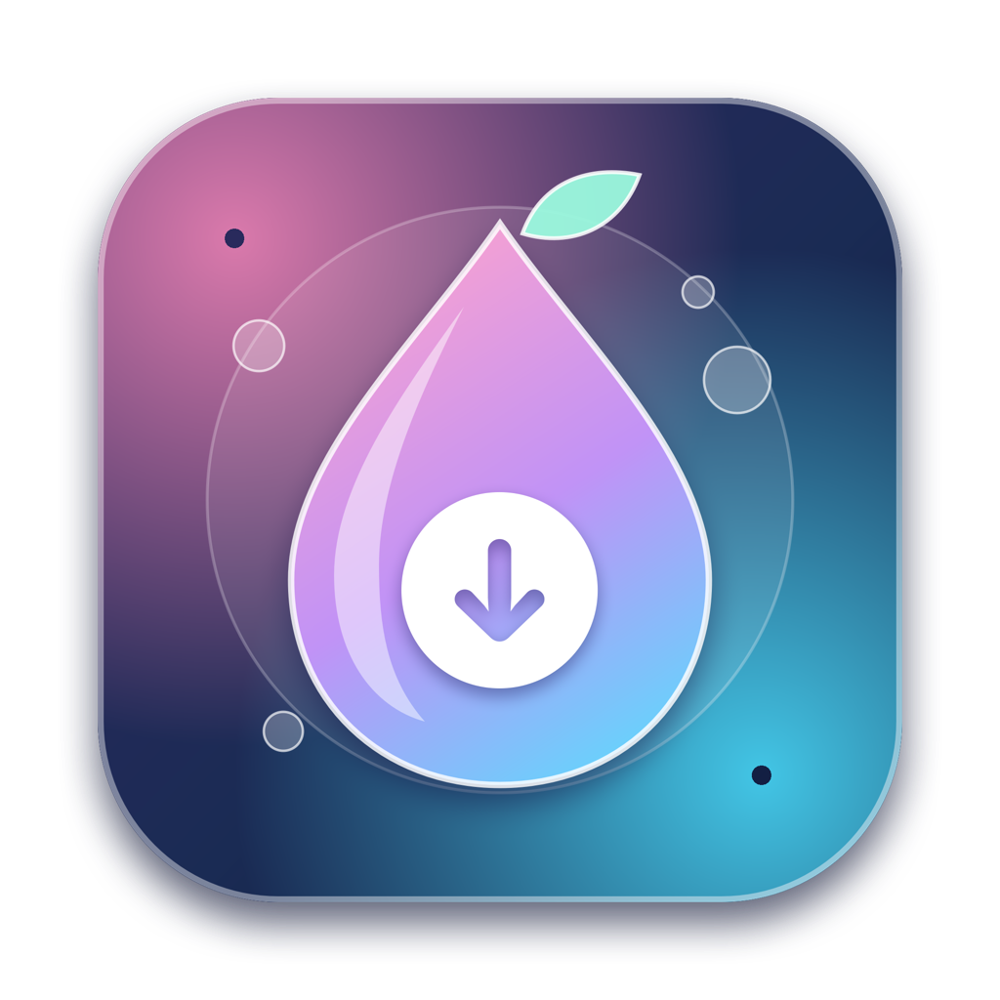
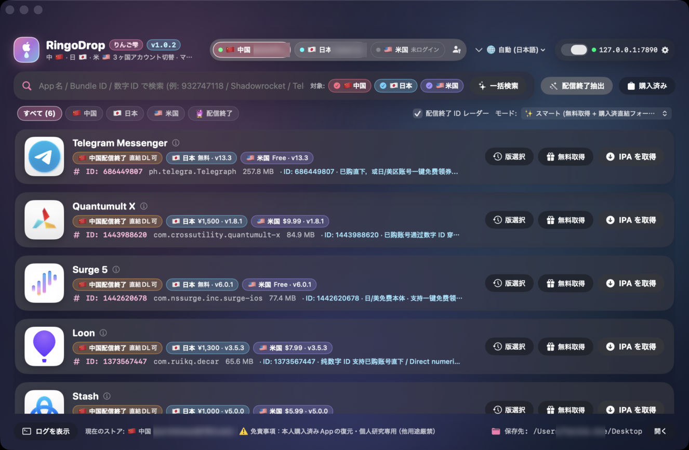
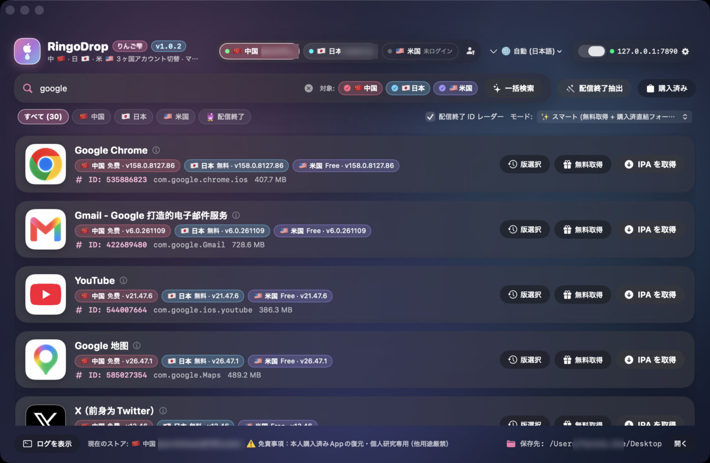

<div align="center">



# 🍎💧 RingoDrop（りんご雫 / 林檎雫）

**macOS 原生 SwiftUI Liquid Glass 风格的 App Store `.ipa` 多国联合搜索、三国账号切换与已下架应用提取工具**  
*A native macOS Liquid Glass App Store `.ipa` downloader, CN/JP/US multi-account switcher & delisted app extractor.*

[](https://www.apple.com/macos/)
[](https://swift.org)
[](https://developer.apple.com/xcode/swiftui/)
[](./LICENSE)

**🇨🇳 简体中文** · [🇯🇵 日本語](./README.ja.md) · [🇺🇸 English](./README.en.md)

</div>

---

## ✨ 简介 | Introduction

**RingoDrop（りんご雫，意为「晶莹的苹果露珠」）** 是一款基于 macOS 原生 **SwiftUI Liquid Glass（液态琉璃）** 视觉风格打造的 App Store `.ipa` 搜索与下载客户端，底层结合 Apple iTunes 公开目录 API 与 [`ipatool`](https://github.com/majd/ipatool) 分发协议。

它专门针对跨区 iOS/iPadOS 用户与老应用收藏者的核心痛点设计：
- 无需在手机或 iTunes 上反复退出/重登账号，即可在顶栏一键管理并切换 **🇨🇳 国区 / 🇯🇵 日区 / 🇺🇸 美区** 三个国家的 Apple ID；
- 支持 **1~3 个国家任意勾选组合** 进行多国并发搜索，同屏对比各国上架状态、价格与当前版本号；
- 针对 **已在特定国家下架的 App**（如国区早年已购应用或隐藏免费应用），支持在单国家模式下自动反查全球唯一数字 `App ID`（`trackId` / `adamId`），并通过 **纯数字 ID 穿透模式（`-i <AppID>`）** 绕过商店前端目录屏蔽，直接从 Apple CDN 拉取带官方 FairPlay 签名的 `.ipa` 安装包。

> [!IMPORTANT]
> **⚠️ 免责声明（Disclaimer）**  
> 1. 本项目**仅限用于找回用户本人合法购买/获取过但丢失的 App，以及个人技术学习与研究**，**严禁用于任何其他用途**（包括但不限于商业牟利、非法分发、盗版传播或任何违反当地法律法规及 Apple 媒体服务条款的行为）。  
> 2. 本工具**不提供**任何破解、绕过或移除 Apple FairPlay DRM 数字版权保护的功能；通过本工具下载的所有 `.ipa` 安装包均保留 Apple 官方签发的、与用户本人 Apple ID 强绑定的 `sinf` 授权签名，仅能在该账号本人授权的设备上安装运行。  
> 3. 使用者应自行承担使用本工具的一切风险与法律责任，项目作者不对任何因不当使用或滥用本工具而产生的后果承担责任。

---

## 📸 界面预览 | Screenshots

### 1. 主界面 · 三国账号切换 & 国区已下架应用直通车
> 顶栏支持 **🇨🇳 国区 / 🇯🇵 日区 / 🇺🇸 美区** 三国 Apple ID 一键切换、**中 / 日 / 英** 三语言切换（默认跟随系统）以及内置 HTTP/HTTPS 代理开关。



### 2. 多国家并发联合搜索（🇨🇳 国区 + 🇯🇵 日区 + 🇺🇸 美区）
> 自由勾选 1~3 个国家并发检索，同一张卡片展示各国上架状态、货币价格、最新版本号与包体大小；支持鼠标悬停显示顶层完整信息浮窗、选历史版本降级与一键免费领券下载。



---

## 🌸 核心特性 | Features

### 1. 💧 原生 macOS Liquid Glass 液态琉璃 UI
- 原生适配 **macOS 26 (`.glassEffect()`)** 液态玻璃折射着色器，并在 macOS 14 / 15 上自动回退至多层高光磨砂琉璃材质（`NSVisualEffectView` + 镜面边缘折射高光）。
- 采用日系 **「桜 (Sakura Pink) × 空 (Sora Cyan) × 菫 (Sumire Violet)」** 极光景深背景。

### 2. 🇨🇳 · 🇯🇵 · 🇺🇸 中/日/美 三国 Apple ID 账号舱与免 2FA 快速切号
- **三国独立槽位**：顶栏常驻 **🇨🇳 国区**、**🇯🇵 日区**、**🇺🇸 美区** 三个账号胶囊，当前在线区服一目了然。
- **原生钥匙串 + 2FA 信任 Cookie 快照**：账号密码仅保存在本机 macOS 系统钥匙串（`SecItem` 专属服务 `moe.haruka.ringodrop.accounts`）中，同时按区服独立快照 `~/.ipatool/cookies.<REGION>`。首次完成双重认证（2FA）后，跨区切换账号会自动恢复对应区服的信任 Cookie，实现一键切号。

### 3. 🔍 可自由组合的多国家联合搜索
- 搜索栏内置 **`[✓ 🇨🇳国区]` `[✓ 🇯🇵日区]` `[✓ 🇺🇸美区]`** 多选开关，可任意勾选单国、双国或三国同时并发检索。
- 自动按全球唯一 `trackId` 合并去重，在同一张卡片上展示该应用在中、日、美三区的上架状态、各国货币价格（`¥` / `無料` / `Free` / `$`）以及最新版本号。

### 4. 🔮 单国家已下架 / 隐藏 App 穿透下载（覆盖已购 / 未购 / 免费）
提供三种可切换的下载策略及独立的 **「🔮 下架提取器」** 弹窗：

| 下载策略 | 适用场景 | 底层机制 |
| :--- | :--- | :--- |
| **✨ 智能模式（默认）** | 绝大多数在架免费应用 & 已购下架应用 | 先尝试带 `--purchase` 自动为未购免费应用申领许可证并下载；若因应用在当前区已下架导致领券接口被拒，**自动无缝回退**至纯数字 ID 已购穿透模式。 |
| **🔓 已购下架直下** | 当前国家已下架、但账号下架前曾购买/获取过的应用（如国区老号买过的 `Shadowrocket` 等） | **只传 `-i <纯数字ID>`（绝不传 `-b` Bundle ID）**，完全跳过商店 `Lookup` 目录接口与 `Purchase` 接口，直接向 `volumeStoreDownloadProduct` 请求最新或历史版本 `.ipa`。 |
| **🎁 未购免费领券直下** | 登录用户尚未购买、但有权限下载的免费应用（或前端隐藏仍开放后端 0 元领券的应用） | 强制按数字 ID 调用 `ipatool purchase -i <AppID>` 为当前账号绑定 0 元免费许可证（“喜加一”入库），随后立即拉取 `.ipa`。 |

- **单国下架数字 ID 雷达**：当只勾选单个国家（如仅选 `🇨🇳 国区`）搜索某款在该国已下架的软件时，若当前国目录返回 0 条结果，软件会自动从跨区档案库反查出该应用的全球唯一数字 ID 与图标，让你在单国模式下依然能搜出并穿透下载已下架应用。

### 5. 🕰️ 历史版本降级 & 灰度最新版直取
- 点击任意应用卡片上的 **「选版本」**，即可调用 `ipatool list-versions -i <AppID>` 列出该应用在 Apple 服务器上的全部历史 `externalVersionIdentifiers`。
- **绕过 7 天灰度限制**：Apple 的分阶段发布（Phased Release）期间，手机 App Store 可能刷不出更新，但版本列表数组首位已包含最新构建 ID，直接点击即可立刻下载最新版；选择旧 ID 即可下载历史旧版本 `.ipa` 进行降级。

### 6. 🌐 内置可配置 HTTP/HTTPS 代理
- 顶栏自带代理一键开关与地址配置（默认 `http://127.0.0.1:7890`）。
- 启用后同时接管 **多国商店目录查询 (`URLSession`)** 与 **`ipatool` 子进程环境变量 (`HTTP_PROXY` / `HTTPS_PROXY`)**，彻底解决国内网络直连 `fpinit.itunes.apple.com` 时常见的 `TLS handshake timeout`。

---

## 🚀 快速开始 | Quick Start

### 1. 前置依赖
RingoDrop 依赖开源命令行工具 [`ipatool`](https://github.com/majd/ipatool) 处理底层的 FairPlay SAP 签名与 `.ipa` 包组装。请先通过 Homebrew 安装：

```bash
brew install ipatool
```

*(若国内下载 Homebrew Bottle 较慢，可使用清华镜像加速：`HOMEBREW_BOTTLE_DOMAIN="https://mirrors.tuna.tsinghua.edu.cn/homebrew-bottles" brew install ipatool`)*

### 2. 一键编译并安装 `RingoDrop.app`

克隆本仓库后，执行内置打包脚本即可自动调用 `swiftc` 编译原生应用并安装至 `/Applications/RingoDrop.app`：

```bash
git clone https://github.com/zorroforever/RingoDrop.git
cd RingoDrop
chmod +x scripts/build_app.sh
./scripts/build_app.sh
```

也可以直接使用 Swift Package Manager 或 Xcode 打开工程：

```bash
# 使用 SwiftPM 编译 Release 二进制
swift build -c release

# 或使用 Xcode 打开工程
open Package.swift
```

---

## 📖 使用指南 | Usage Guide

1. **配置代理（推荐）**  
   启动 **RingoDrop** 后，确认右上角代理胶囊处于开启状态（默认 `127.0.0.1:7890`，点击齿轮图标可修改为你本地 Clash / Surge / V2Ray 的 HTTP 端口）。
2. **登录中 / 日 / 美 Apple ID**  
   点击顶栏的 **`🇨🇳 国区`**、**`🇯🇵 日区`** 或 **`🇺🇸 美区`** 胶囊：
   - 输入对应区服的 Apple ID 邮箱与密码；
   - **一步秒登技巧**：在 iPhone 上进入 `设置 -> 顶部 Apple 账户 -> 登录与安全性 -> 双重认证 -> 获取验证码`，将生成的 6 位验证码直接填入登录框再点登录，只需一次握手即可完成认证。
3. **搜索与一键下载 `.ipa`**  
   - 在搜索框输入应用名（如 `Shadowrocket`、`Telegram`、`微信`、`ウマ娘`）、`Bundle ID` 或纯数字 `App ID`，勾选想要检索的国家后点击 **「多国联搜」**；
   - 点击卡片右侧的 **「一键下载 IPA」** 即可自动完成领券/校验并下载 `.ipa` 到本地（下载完成后可点击 **「在访达中显示 IPA」** 直接定位文件）。
4. **安装下载好的 `.ipa`**  
   下载得到的 `.ipa` 包含绑定下载账号的官方 FairPlay `sinf` 签名，可直接通过 **Apple Configurator 2**、**Finder（访达）**、**iMazing** 或 **爱思助手** 拖拽安装到已登录过该 Apple ID 的 iPhone / iPad 上，应用数据与聊天记录均会完整保留。

---

## 📁 目录结构 | Project Structure

```text
RingoDrop/
├── Package.swift                      # Swift Package Manager 工程定义
├── assets/
│   ├── icon.png                       # RingoDrop (りんご雫) Liquid Glass 图标
│   ├── screenshot-home.png            # 主界面与已下架直通车截图
│   └── screenshot-search.png          # 多国家联合搜索界面截图
├── Sources/
│   └── RingoDrop/
│       └── RingoDropApp.swift         # SwiftUI Liquid Glass 主程序与核心控制器
├── scripts/
│   ├── generate_icon.swift            # 1024x1024 Retina .icns 图标生成脚本
│   └── build_app.sh                   # 一键编译打包 macOS .app Bundle 脚本
├── LICENSE                            # MIT 开源许可证
└── README.md                          # 项目说明文档
```

---

## 🔒 隐私与安全说明 | Security & Privacy

- **纯本地运行**：RingoDrop 不包含任何第三方后端或统计遥测服务，所有网络请求仅在你的 Mac 本地与 Apple 官方服务器（`itunes.apple.com`、`buy.itunes.apple.com`、`fpinit.itunes.apple.com`）之间直接通信。
- **系统级凭据保护**：勾选“记住密码”时，密码仅存储在你本机的 **macOS 系统钥匙串（Keychain）** 中；所有日志输出均会自动对密码参数（`-p ********`）做脱敏处理。

---

## ⚠️ 免责声明 | Disclaimer

- **用途严格受限**：本软件及源码**仅用于协助用户找回自己合法购买/拥有过但丢失的 App 安装包备份，以及个人非商业性质的技术学习与研究，不得用于其他任何用途**。
- **尊重知识产权与 DRM**：本工具仅作为官方分发接口的本地客户端封装，绝不修改应用二进制代码，亦不绕过 Apple FairPlay DRM 加密校验。请支持正版软件开发者。
- **责任豁免**：下载、编译或使用本项目即代表您已阅读并同意上述声明；因违反本声明或相关服务条款所引发的一切法律责任与账号风险均由使用者本人自行承担。

---

## 📄 开源许可 | License

本项目基于 [MIT License](./LICENSE) 开源。感谢 [@majd/ipatool](https://github.com/majd/ipatool) 提供的底层 App Store 分发协议实现。
